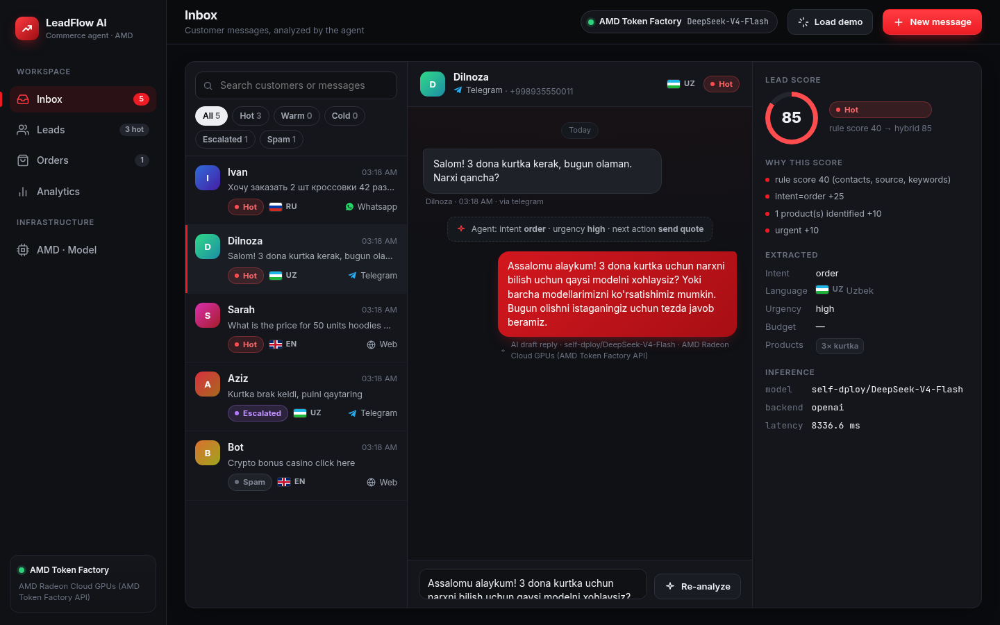
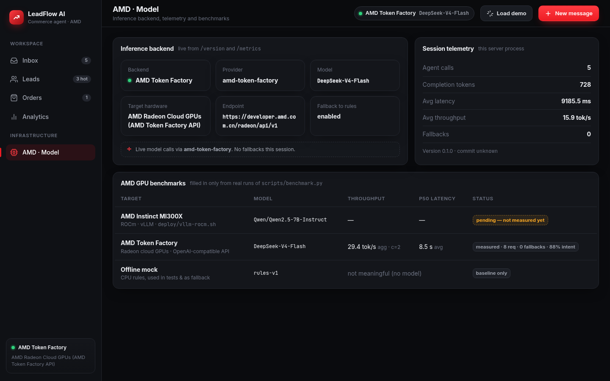

# Live proof — AMD Token Factory (2026-10-18)

## Default: Google Gemma `Gemma-4-31B-IT` on AMD GPUs

Since 2026-10-18 the app's default model is **Google Gemma `Gemma-4-31B-IT`**, served on AMD Radeon cloud GPUs by
AMD Token Factory (the endpoint reports the deployment as `self-dploy/Gemma-4-31B-IT`). Same base URL, same key,
`LLM_TIMEOUT=90` (Gemma is slower than DeepSeek-V4-Flash on the shared endpoint).

### `python -m app.llm`
```json
{ "backend": "openai", "provider": "amd-token-factory", "model": "Gemma-4-31B-IT",
  "model_available": true, "sample": { "intent": "quote", "language": "uz", "latency_ms": 21998.4, "completion_tokens": 148 },
  "ok": true }
```

### `./scripts/demo.sh` — 5 leads, RU / UZ / EN, Gemma (score | name | intent | action | backend | latency | AI reply)
```
100 | Ivan    | order     | create_order_draft | openai | 20190ms | Здравствуйте! Приняли ваш заказ на 2 пары кроссовок. Мы свяж…
75  | Dilnoza | quote     | send_quote         | openai | 23473ms | Assalomu alaykum! Kurtkalarimiz narxini hozir aytaman. Iltim…
70  | Sarah   | quote     | send_quote         | openai | 19519ms | Hello! Thank you for your inquiry. We can certainly help you…
60  | Aziz    | complaint | escalate           | openai | 22907ms | Kechirasiz, noqulayliklar uchun uzr so'raymiz. Iltimos, buyu…
0   | Bot     | spam      | ignore             | openai | 10848ms | (no reply for spam)

orders:  [{"lead_id":1,"items":[{"name":"кроссовки 42 размера","qty":2}],"budget":900000.0,"currency":"UZS","status":"draft"}]
metrics: {"calls":5,"completion_tokens":682,"fallbacks":0,"avg_latency_ms":19387.3,"avg_tokens_per_sec":7.0,
          "llm":{"provider":"amd-token-factory","model":"Gemma-4-31B-IT"}}
```
5/5 valid JSON, 5/5 expected intents, 0 fallbacks; the order draft even normalised the currency to `UZS`.
Shared public endpoint, so latency includes queueing (one single call hit a >60 s spike, hence the 90 s timeout).

## Alternative: `DeepSeek-V4-Flash` (earlier run, same day)

LeadFlow AI running against the **AMD Token Factory** OpenAI-compatible API — no mock, no fallbacks.

| | |
|---|---|
| Base URL | `https://developer.amd.com.cn/radeon/api/v1` |
| Model | `DeepSeek-V4-Flash` (alternative; set `AMD_TOKEN_FACTORY_MODEL=DeepSeek-V4-Flash`) |
| Hardware | AMD Radeon cloud GPUs (Token Factory) |
| How | `./scripts/go_live.sh rc-…` → `python serve.py` → `./scripts/demo.sh` |

## `./scripts/go_live.sh --check`
```json
{ "backend": "openai", "provider": "amd-token-factory", "model": "DeepSeek-V4-Flash",
  "model_available": true, "sample": { "intent": "quote", "language": "uz", "latency_ms": 9206.5, "completion_tokens": 145 },
  "ok": true }
```

## `./scripts/demo.sh` — 5 leads, RU / UZ / EN (score | name | intent | action | backend | latency | AI reply)
```
100 | Ivan    | order     | create_order_draft | openai | 18498ms | Здравствуйте! Спасибо за заказ. Уточните, пожалуйста, модель…
85  | Dilnoza | order     | send_quote         | openai | 16398ms | Assalomu alaykum! 3 dona kurtka uchun narxni bilish uchun yo…
70  | Sarah   | quote     | send_quote         | openai |  5650ms | Thank you for your inquiry! We will prepare a quote for 50 h…
60  | Aziz    | complaint | escalate           | openai |  7475ms | Kechirasiz, kurtka sifati bilan bog'liq muammo uchun uzr so'…
0   | Bot     | spam      | ignore             | openai |  4755ms | Sorry, we don't handle such requests. How can I help you wit…

orders:  [{"lead_id":1,"items":[{"name":"кроссовки","qty":2}],"budget":900000.0,"currency":"сум","status":"draft"}]
metrics: {"calls":5,"completion_tokens":716,"fallbacks":0,"avg_latency_ms":10555.1,"avg_tokens_per_sec":13.6,
          "llm":{"provider":"amd-token-factory","model":"DeepSeek-V4-Flash"}}
```

## `python -m scripts.benchmark --concurrency 2 --rounds 1`
8 requests (RU/UZ/EN), 0 fallbacks, intent accuracy **0.875**, aggregate **29.4 tok/s**, avg latency **8.5 s**,
0.22 req/s. Raw: [`live-benchmark-tokenfactory.json`](live-benchmark-tokenfactory.json).
Shared public endpoint, so latency includes queueing; dedicated MI300X numbers remain *pending*.

## Dashboard
Inbox — Uzbek lead answered live by DeepSeek-V4-Flash on AMD Token Factory:



AMD · Model — backend, telemetry, measured Token Factory benchmark:


